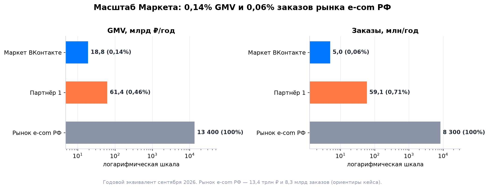
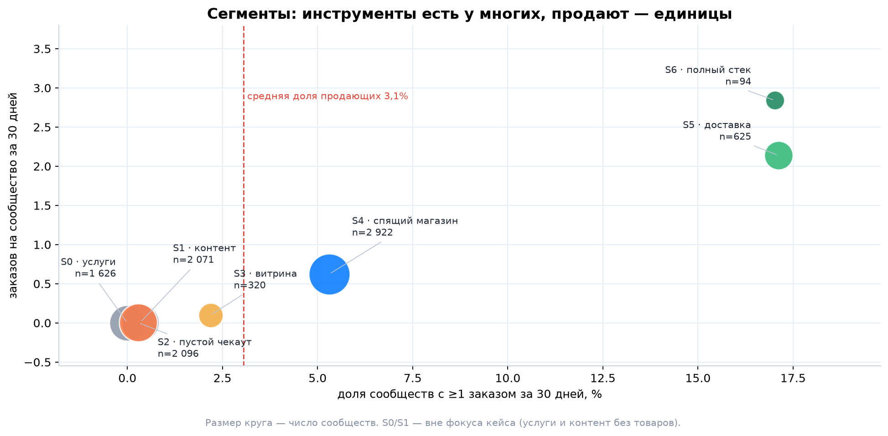
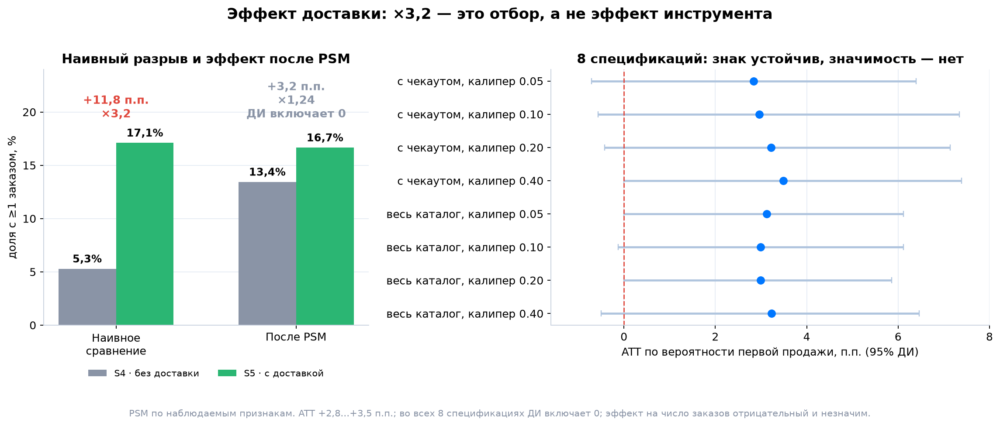
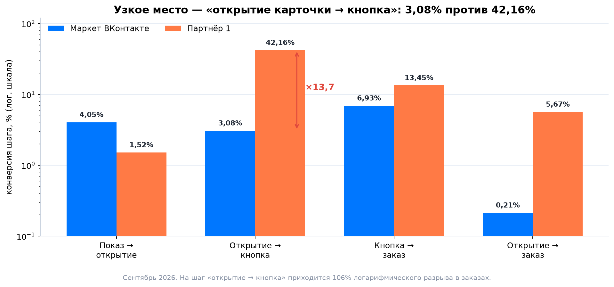
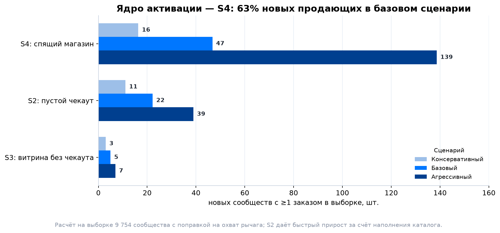
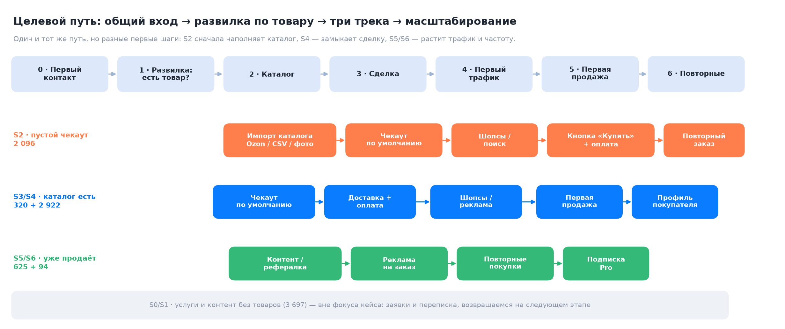
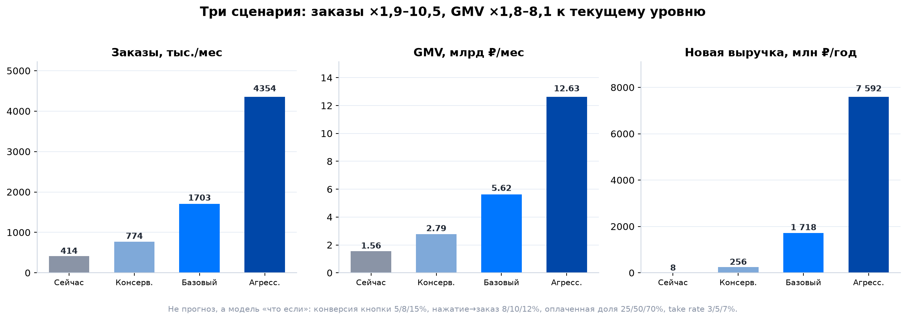

# Социальная коммерция ВКонтакте: результаты исследования

## Handover-документ для команды

**VK Case Championship 2026 · отборочный этап · кейс «Развитие элементов социальной коммерции для бизнес-сообществ во ВКонтакте»**

Дата: 15 ноября 2026 · Версия 1.0 · Период данных: сентябрь 2026 · Выборка: 9 754 бизнес-сообщества

> **Как пользоваться документом.** Это не презентация и не финальный ответ, а рабочая база: здесь собраны проверенные числа, интерпретации, границы применимости и готовые формулировки для слайдов. Всё, что можно пересчитать, лежит в `outputs/` и воспроизводится командой `python run_all.py`. Если меняете число — меняйте его в ноутбуке, а не в тексте.

---

## Содержание

1. Три минуты: главное
2. Контекст кейса и требования из PDF
3. Данные, метод и границы выводов
4. Ключевые результаты исследования
5. Ответы на пять задач кейса
6. Целевая концепция: «Маркет как слой»
7. Сценарии, монетизация и KPI
8. План проверки: эксперименты, дорожная карта, риски
9. Как упаковать это в 8 слайдов
10. Что делать коллегам дальше
11. Карта файлов и воспроизводимость
12. Раскрытие использования ИИ
13. Приложения: глоссарий, ключевые числа, список рисунков

---

## 1. Три минуты: главное

1. **Проблема не в спросе, а в замыкании сделки.** У ВКонтакте 90,8 млн DAU и более миллиона бизнес-сообществ, но только **3,1%** сообществ выборки имеют хотя бы один заказ через чекаут. Из 5 737 сообществ с подключённым чекаутом продают **284**, то есть **4,95%**; **94,8%** «спят».
2. **Узкое место — шаг «открытие карточки → нажатие кнопки».** У Маркета ВКонтакте он даёт **3,08%** против **42,16%** у Партнёра 1. На этот шаг приходится **106%** логарифмического разрыва в заказах; состав категорий объясняет **−14%**, а механика внутри категорий — **+114%**.
3. **Инструменты не работают по отдельности.** Ассортимент — сильнейший наблюдаемый предиктор первой продажи (OR≈1,52 на e× каталога, топ-1 важность в ML). Доставка наивно даёт ×3,2, но после PSM — лишь **+2,8…3,5 п.п.**, и во всех 8 спецификациях доверительный интервал включает ноль. Это не «доставка не нужна», это «доставка без каталога, трафика и исполнения не создаёт продажу».
4. **Товарный контент — канал охвата, а не конверсии.** Товарные публикации получают в **1,9 раза** больше просмотров на публикацию, но их ER в **1,8 раза** ниже, а CTR в карточку — **0,29%**. Публикуют товарный контент только **3,1%** сообществ. Потенциал — в формате и CTA, а не в количестве постов.
5. **Реклама не доказала связь с продажей.** 542 сообщества платят за рекламу; у **501 (92,4%)** нет измеримого заказа, на них приходится **87,6%** бюджета. Связь трат с вероятностью первой продажи статистически незначима (OR≈1,02, p=0,31). Модель «продавать трафик» упирается в потолок доверия.
6. **Стратегический ответ — не строить второй маркетплейс, а стать слоем сделки.** Маркет ВКонтакте — это **0,14% GMV** и **0,06% заказов** рынка e-com РФ, его DAU — **0,14%** от DAU ВКонтакте. Зато 27,3 млн человек в месяц открывают карточки, а 28,6 млн запросов в товарном поиске ждут интента. Нужно превратить Маркет из «места» в **инфраструктуру: каталог + карточка-сделка + чекаут + доставка/оплата + поиск + профиль покупателя**.
7. **Целевой сегмент — S4 «спящий магазин»: 2 922 сообщества, 30% выборки, 5,3% продающих.** Это ядро активации: у них уже есть каталог и чекаут, но нет доставки/оплаты. S2 (2 096) — быстрый прирост через импорт каталога, S3 (320) — quick win, S5/S6 (719) — рост объёма и монетизации. S0/S1 (3 697) — вне фокуса кейса.
8. **Базовая модель:** 1,70 млн заказов/мес и 5,62 млрд ₽ GMV/мес; новая выручка от комиссии и подписки — **143 млн ₽/мес** (1,72 млрд ₽/год). Консервативный сценарий — 774 тыс. заказов и 21 млн ₽/мес; агрессивный — 4,35 млн заказов и 633 млн ₽/мес. Это не прогноз, а модель «что если» с явными допущениями.
9. **Главный риск — переоценить эффект.** Наблюдательные данные, self-selection, один месяц, 98,8% заказов не оплачены внутри VK. Все обещания должны идти через A/B и сопровождаться доверительными интервалами. В отчёте есть отдельный список «что нельзя утверждать».

---

## 2. Контекст кейса и требования из PDF

### 2.1. Что просит кейс

Кейс — про **социальную коммерцию для бизнес-сообществ**, а не про авторов и не про рекламный кабинет. Ключевая цель сформулирована на слайде постановки задачи:

> **Увеличить число бизнесов, продающих через ВКонтакте. Ориентиры — число бизнесов, подключивших инструменты продаж, и число заказов, оформленных внутри ВКонтакте.**

Из этого следуют два измерения успеха, которые нельзя путать:

| Измерение | Метрика кейса | Где она живёт в модели |
|---|---|---|
| Ширина воронки | число бизнесов, подключивших инструменты продаж | доля сообществ с каталогом, чекаутом, доставкой, оплатой |
| Глубина сделки | число заказов, оформленных внутри ВКонтакте | заказы/мес, GMV/мес, оплаченные заказы |

**Практический вывод:** сначала растёт «ширина» (подключение), потом «глубина» (заказы). Нельзя отчитываться только подключениями: 94,8% подключивших чекаут не продают.

### 2.2. Пять задач кейса

| № | Задача | Что должно быть в ответе | Где в отчёте |
|---|---|---|---|
| 1 | Определить место ВКонтакте для бизнеса среди маркетплейсов, классифайдов и других каналов | анализ рынка, российские и международные практики, позиционирование | раздел 5.1, 4.1 |
| 2 | Выбрать целевые бизнесы: что им нужно, чего хотят, с какими трудностями сталкиваются; что мешает расти; как помочь | сегменты, барьеры, приоритеты | раздел 4.2, 5.2 |
| 3 | Сформулировать уникальное предложение и инструменты продвижения, продаж, работы с клиентами; эффект для бизнеса и VK | ценностное предложение, 5 рычагов, таблица двухсторонних эффектов | раздел 6, 5.3 |
| 4 | Проанализировать данные и открытые источники, определить роль Маркета ВКонтакте | альтернативы A/B/C, выбранная роль, метрики | раздел 4.1, 5.4 |
| 5 | Спроектировать и обосновать целевой путь бизнеса от первого контакта до продажи, с развилками и инструментами на каждом этапе | карта пути, развилки по сегментам, метрики этапов | раздел 7, 5.5 |

### 2.3. Требования к сдаче

| Требование | Деталь |
|---|---|
| Формат | презентация PDF, **8 слайдов** |
| Приложения | без ограничений по количеству |
| Имя файла | `название команды_strategy_msk/spb` |
| Дедлайн | **22 ноября, 09:00**; одна заявка от команды; доступ к файлам не закрывать до конца чемпионата |
| Структура | титул → команда и город → Executive Summary → проблематика → альтернативы → выбранная концепция → обоснование → выводы и рекомендации |
| Критерии | глубина, широта, структура и логика, соответствие задаче, анализ датасета, качество презентации |
| ИИ | использование раскрыть: какие инструменты, для каких задач, чем помогли; результаты проверить |

**Важно:** PDF прямо говорит, что кейс не предполагает единственного верного решения, а часть данных могла быть намеренно искажена или упрощена. Поэтому в презентации нужно не «угадать ответ», а показать **логику, расчёты, альтернативы и границы**. Это же требование к глубине и широте анализа.

### 2.4. Критерии оценки — как их закрывать

| Критерий | Что делать в deck | Артефакт |
|---|---|---|
| Глубина | показать механику: воронка, декомпозиция, PSM, чувствительность | рис. 3–6, 8–10 |
| Широта | рынок, сегменты, инструменты, финансы, риски, план | разделы 4–9 |
| Структура и логика | единая линия: проблема → альтернативы → концепция → обоснование → выводы | раздел 10 |
| Соответствие задаче | явно ответить на 5 вопросов, не уходить в услуги и авторов | раздел 5 |
| Анализ датасета | числа из данных, не «экспертные ощущения»; указать ограничения | разделы 3–4 |
| Качество | деловой стиль, аккуратные графики, без опечаток | приложение, figures |

---

## 3. Данные, метод и границы выводов

### 3.1. Что в датасете

Датасет — 7 листов Excel за сентябрь 2026:

| Лист | Гранулярность | Что даёт | Ограничение |
|---|---|---|---|
| Бизнесы | сообщество × 30 дней, 9 754 строки | сегменты, инструменты, контент, заказы через чекаут, реклама | нет продаж мимо чекаута (сообщения, внешний сайт) |
| Маркет ВКонтакте — итоги | сегмент × 30 дней, 26 строк | воронка, GMV, покупатели, DAU/MAU | у Партнёра нет «оплаченных заказов» |
| Маркет ВКонтакте — по дням | день × сегмент, 30 дней | динамика, тренды, день недели | уникальных покупателей нельзя суммировать по дням |
| Маркет ВКонтакте — источники | источник × сегмент | структура открытий карточки | нет заказов в разрезе источника |
| Маркет ВКонтакте — категории | категория × сегмент, 18 категорий | конверсия и ассортиментный разрыв | суммы заказов расходятся с итогами на 5–7% |
| Покупатели | пол × возраст × сегмент | профиль покупателя, заказы на покупателя | группы <100 скрыты |
| Покупатели по регионам | регион × сегмент, 89 регионов | гео-концентрация | нет населения регионов, группы <100 скрыты |

### 3.2. Выборка — не вся платформа

Это первое, что нужно проговорить на защите, иначе любое «умножение на миллион» будет ошибкой.

| Показатель | Выборка | Платформа | Доля выборки |
|---|---:|---:|---:|
| Заказы оформленные | 3 478 | 413 740 | 0,84% |
| Заказы оплаченные | 3 478 | 4 903 | **70,9%** |
| GMV, ₽ | 9 973 027 | 1 564 546 740 | **0,64%** |
| Открытия карточки из контента | 53 068 | 86 321 893 | 0,06% |

Выборка **перепредставлена оплаченными заказами** (70,9% всех оплаченных заказов платформы) и **недопредставлена GMV** (0,64%). Поэтому:

- **нельзя** экстраполировать абсолютные заказы и GMV выборки на платформу;
- **можно** переносить структуру, доли, относительные эффекты и направления;
- для платформенных сценариев считаем от платформенных метрик (413,7 тыс. заказов, 1,56 млрд ₽), а не от выборки.

### 3.3. Аномалии и как мы с ними обращались

| Аномалия | Масштаб | Почему проблема | Решение |
|---|---:|---|---|
| Чекаут подключён, каталог пуст | 2 096 | технически чекаут без товаров невозможен | выделен в S2, не считается «готовым к продажам» |
| Просмотры товарного контента без публикаций с товаром | 1 013 | разная атрибуция окон | парные тесты только там, где есть и публикации, и просмотры |
| Открытия карточки > просмотров товарного контента | 40 | нарушение вложенности воронки | исключены из CTR карточки |
| Заказы > 0, GMV = 0 | 7 | незаполненные суммы | AOV считаем на агрегате |
| Доставка или оплата без чекаута | 168 | нарушение логики стека | строгая вложенность в воронке |
| «Средний чек» ≠ GMV/заказы | 291 | медианное отношение ≈1,18 | везде расчётный AOV = GMV/заказы |

Дополнительно: суммы заказов по категориям расходятся с итогами на **+5,2%** (Маркет) и **−7,5%** (Партнёр); открытия «из постов и клипов» расходятся с источниками «Лента + Клипы» на **−26%** из-за разной атрибуции. Поэтому в категорийном анализе смотрим на структуру и отношения, а не на абсолютные суммы.

### 3.4. Методы

| Метод | Где | Зачем | Что не даёт |
|---|---|---|---|
| Сегментация по стеку инструментов | ноутбук 01 | выделить S0–S6 и целевые группы | не является causal-дизайном |
| Воронка и декомпозиция шагов | ноутбук 03 | найти узкое место | не объясняет, почему шаг плохой |
| Логит + ML | ноутбук 02 | какие признаки связаны с первой продажей | ассоциация, не эффект |
| PSM | ноутбуки 02, 05 | скорректировать self-selection по наблюдаемым признакам | не убирает ненаблюдаемый отбор |
| Разложение «состав vs механика» | ноутбук 05 | отделить микс категорий от конверсии внутри категорий | 17 категорий, суммы не сходятся |
| Тренды с фиксированными эффектами дня недели | ноутбук 05 | убрать календарный артефакт | 30 наблюдений, нет сезонности |
| Сценарная модель | ноутбук 04 | оценить порядок эффекта и чувствительность | не прогноз; допущения явные |

### 3.5. Статус доказательности

Договоримся о языке, чтобы не спорить на защите:

| Статус | Что это | Пример |
|---|---|---|
| **Факт** | прямо измерено в данных | 3,08% открытие→кнопка у Маркета |
| **Ассоциация** | устойчивая связь после контроля | доставка связана с +3 п.п. активации после PSM |
| **Гипотеза** | требует эксперимента | «доставка из коробки даст +3 п.п.» |
| **Сценарий** | модель при явных допущениях | 1,70 млн заказов/мес в базовом сценарии |

В презентации предлагаю маркировать утверждения именно так — это сильный ход для критерия «глубина».

---

## 4. Ключевые результаты исследования

### 4.1. Место ВКонтакте и Маркета на рынке

**Рынок.** РФ e-com — 13,4 трлн ₽ GMV и 8,3 млрд заказов в год; 81% заказов приходится на маркетплейсы. Средний чек по рынку — около 1 600 ₽.

**ВКонтакте.** 90,8 млн DAU, 97% месячного охвата рунета, более миллиона бизнес-сообществ, более 200 тыс. продавцов с каталогом (публичная оценка).

**Маркет ВКонтакте.** Если пересчитать сентябрь 2026 в год:

| Игрок | GMV, млрд ₽/год | Доля рынка | Заказы, млн/год | Доля рынка |
|---|---:|---:|---:|---:|
| Рынок e-com РФ | 13 400 | 100% | 8 300 | 100% |
| Партнёр 1 | 61,4 | 0,46% | 59,1 | 0,71% |
| **Маркет ВКонтакте** | **18,8** | **0,14%** | **5,0** | **0,06%** |



**Масштаб внутри ВКонтакте:**

| Метрика | Значение | Комментарий |
|---|---:|---|
| DAU Маркета | 127,4 тыс. | 0,14% от DAU ВКонтакте 90,8 млн |
| MAU Маркета | 3,0 млн | — |
| DAU/MAU | 4,3% | низкая частота возврата |
| Видели товары за 30 дней | 66,6 млн | витрина/карточки по всей платформе |
| Открывали карточку за 30 дней | 27,3 млн | 41% увидевших |
| Запросы в товарном поиске | 28,6 млн/мес | 18,4% с открытием карточки |

**Интерпретация.** Маркет не может быть «вторым Ozon/WB»: у него нет ни аудитории destination, ни логистики, ни ассортиментной экономики. Но у ВКонтакте есть то, чего нет у маркетплейсов: **контентный трафик, доверие к сообществам и 27 млн человек, которые уже открывают карточки**. Стратегическая роль — не «место», а **слой сделки внутри экосистемы**.

**Альтернативы роли Маркета:**

| Альтернатива | Что говорят данные | Вердикт |
|---|---|---|
| A. Самостоятельный маркетплейс (destination) | DAU 0,14% от VK; DAU/MAU 4,3%; конверсия открытие→заказ 0,21%; 46% трафика — категории с конверсией <0,1%; заказы −10,7% за месяц | **Не рекомендуется**: нет аудитории и экономики для лобовой конкуренции |
| B. Товарная инфраструктура + поиск + витрина внутри сообщества | 27,3 млн открывают карточки вне Маркета; 28,6 млн запросов; 92,7% открытий Партнёра — из контента; узкое место «карточка→кнопка» ×13,7; не нужна своя логистика | **Рекомендуется**: превращает Маркет из места в слой (catalog + checkout + trust + search) |
| C. Полностью закрыть отдельную витрину | 79,5% открытий Маркета — витрина/браузинг; «Главная Маркета» — 0,2%; но поиск — 1,9% и 28,6 млн запросов | **Частично**: закрывать «Главную как destination», сохранять поиск, заказы и профиль покупателя |

### 4.2. Сегменты: где находятся целевые бизнесы

Сегментация — по стеку инструментов, а не по размеру или тематике. Это важно: она сразу показывает, **что уже подключено** и **чего не хватает**.

| Сегмент | n | Доля выборки | Продающих | Заказов/бизнес | AOV, ₽ | GMV, ₽ | Роль |
|---|---:|---:|---:|---:|---:|---:|---|
| S0. Услуги без каталога | 1 626 | 16,7% | 0,0% | 0,00 | — | 0 | вне фокуса |
| S1. Контент/переписка без товаров | 2 071 | 21,2% | 0,34% | 0,01 | 7 071 | 91 920 | вне фокуса |
| S2. Чекаут без каталога (аномалия) | 2 096 | 21,5% | 0,29% | 0,003 | 2 291 | 16 040 | быстрый охват |
| S3. Витрина без чекаута | 320 | 3,3% | 2,19% | 0,10 | 11 306 | 361 780 | quick win |
| **S4. Каталог + чекаут** | **2 922** | **30,0%** | **5,30%** | **0,62** | **2 323** | **4 234 339** | **ядро** |
| S5. Каталог + чекаут + доставка | 625 | 6,4% | 17,12% | 2,14 | 3 308 | 4 420 108 | рост объёма |
| S6. Полный стек (+оплата) | 94 | 1,0% | 17,02% | 2,84 | 3 179 | 848 840 | масштаб |



**Что видно:**

- **S4 — 30% выборки, но только 5,3% продающих.** У них есть каталог (медиана 9 SKU) и чекаут, но нет доставки. Это самый большой адресуемый сегмент: 2 922 сообщества.
- **S2 — 2 096 сообществ с «пустым чекаутом».** Технически это аномалия, но с точки зрения бизнеса — это люди, которые уже нажали «подключить продажи», но не наполнили каталог. Быстрый прирост даёт импорт каталога.
- **S5/S6 — 719 сообществ, 17% продающих.** Они уже продают; им нужен новый трафик, повторные покупки и монетизация, а не «ещё один чекаут».
- **S3 — 320 сообществ, витрина без чекаута.** Быстрый win: включить чекаут по умолчанию.
- **S0/S1 — 3 697 сообществ (38%).** Услуги и контент без товаров; кейс просит сфокусироваться на товарах, поэтому в первый год не тратим на них ресурс.

**Портреты целевых сегментов:**

| Сегмент | Профиль из данных | Цель бизнеса | Барьер | Что даём |
|---|---|---|---|---|
| S4 «Спящий магазин» | каталог ~9 SKU, 665 подписчиков, чекаут есть, доставки нет | заказы без своего сайта и логистики | не может исполнить заказ: доставка/оплата не подключены; карточка не ведёт к сделке | доставка «из коробки» + оплата + автогенерация карточек; обучение в 3 шага |
| S3 «Витрина-каталог» | каталог ~20 SKU, 1 300 подписчиков, чекаута нет | показывать ассортимент и получать заявки | сделка уходит в сообщения, теряется конверсия и учёт | чекаут по умолчанию + шаблоны ответов с карточкой |
| S2 «Пустой чекаут» | чекаут подключён, каталог пуст, 280 подписчиков | попробовать продажи без затрат | нет наполненного каталога | импорт из маркетплейса/CSV, карточка из фото |
| S5/S6 «Работающий продавец» | 39–59 SKU, 1 000–1 250 подписчиков, доставка есть | масштабировать заказы и повторные покупки | мало нового трафика; товарный контент не даёт переходов | шопсы + реклама на карточку + рефералка + оплата внутри VK |

### 4.3. Воронка активации: инструмент ≠ сделка

Вложенная воронка торгового стека:

| Шаг | n | Доля от всех | Шаговая конверсия |
|---|---:|---:|---:|
| Бизнес-сообщество в выборке | 9 754 | 100% | — |
| Активный каталог (≥1 товар) | 3 961 | 40,6% | 40,6% |
| + подключён чекаут | 3 641 | 37,3% | 91,9% |
| + подключена доставка | 719 | 7,4% | 19,7% |
| + подключена оплата (полный стек) | 94 | 1,0% | 13,1% |


**Ключевой разрыв — не в подключении, а в результате:**

| Шаг | Сообществ | Доля от чекаута |
|---|---:|---:|
| Подключили чекаут | 5 737 | 100% |
| Из них сделали ≥1 заказ | 284 | 4,95% |
| Из них сделали ≥5 заказов | 90 | 1,57% |
| Подключили доставку | 919 | 16,0% |
| Подключили оплату | 255 | 4,4% |

**Проникновение инструментов и поведения:**

| Индикатор | n | Доля |
|---|---:|---:|
| Подключён чекаут | 5 737 | 58,8% |
| Товары загружены | 4 779 | 49,0% |
| Активный каталог | 3 961 | 40,6% |
| Подключена доставка | 919 | 9,4% |
| Платит за рекламу | 542 | 5,6% |
| Есть открытия карточки из контента | 437 | 4,5% |
| Публикует товарный контент | 303 | 3,1% |
| ≥1 заказ через чекаут | 298 | 3,1% |
| Подключена оплата | 255 | 2,6% |
| Участвует в реферальной программе | 201 | 2,1% |
| ≥5 заказов через чекаут | 93 | 1,0% |


**Вывод.** Проблема не в том, что бизнес не подключает инструменты: чекаут подключён у 58,8%. Проблема в том, что **подключение не превращается в сделку**. Это подтверждает гипотезу кейса: нужен не «ещё один инструмент», а связка «каталог → карточка → кнопка → оплата → исполнение».

### 4.4. Что связано с первой продажей

Логит вероятности ≥1 заказа (n=9 754):

| Признак | OR | 95% ДИ | p-value | Интерпретация |
|---|---:|---|---:|---|
| checkout | 8,27 | 3,69–18,54 | <0,001 | тавтологичен: без чекаута нет заказа |
| delivery | 1,59 | 1,18–2,14 | 0,002 | связано с более высокой активацией |
| log_sku | 1,52 | 1,39–1,65 | <0,001 | каждый e× каталога — +52% к шансу |
| log_views_reg | 1,45 | 1,30–1,61 | <0,001 | охват важен |
| has_prod_content | 1,51 | 0,96–2,36 | 0,073 | на грани значимости |
| log_subs | 1,19 | 1,07–1,33 | 0,002 | размер аудитории |
| payment | 1,14 | 0,71–1,82 | 0,60 | эффект не выделяется |
| referral | 1,14 | 0,60–2,16 | 0,69 | мало данных |
| log_ad_spend | 1,02 | 0,98–1,06 | 0,31 | связи с первой продажей нет |
| log_content | 0,81 | 0,70–0,92 | 0,002 | больше постов без каталога — ниже активация |


ML-модель (AUC 0,84, AP 0,39) ставит **размер активного каталога** на первое место по важности. Это не причинный эффект, но сильный сигнал: **ассортимент — первый экран онбординга**, а не «настройка кнопки».

### 4.5. Доставка: наивный разрыв и PSM

Наивное сравнение: S5 (с доставкой) — 17,1% продающих, S4 (без доставки) — 5,3%; отношение **×3,2**, разница **+11,8 п.п.** (95% ДИ 8,9–15,1; p<0,001).

Но S5 и S4 различаются не только доставкой:

| Показатель | S4 | S5 |
|---|---:|---:|
| Медиана подписчиков | 665 | 1 000 |
| Медиана активных SKU | 9 | 39 |
| Медиана публикаций за 30 дней | 3 | 5 |
| Доля с товарным контентом | 3,7% | 12,5% |
| Доля продающих | 5,3% | 17,1% |

После PSM по наблюдаемым признакам:

| Outcome | Наивно | После PSM | ATT | 95% ДИ |
|---|---:|---:|---:|---|
| Доля продающих | 17,1% vs 5,3% (×3,2) | 16,7% vs 13,4% (×1,24) | **+3,2 п.п.** | **−0,4…+7,1** |
| Заказов на бизнес | 2,23 vs 0,62 | 2,20 vs 2,79 | −0,60 | −2,71…+1,24 |
| GMV на бизнес, ₽ | 7 328 vs 1 449 | 7 019 vs 5 715 | +1 304 | −2 885…+5 834 |



В 8 спецификациях PSM (2 контроля × 4 калипера) ATT активации — **+2,8…+3,5 п.п.**, но **во всех 8 ДИ включает 0**; эффект на число заказов — **−0,3…−1,1** и незначим. Это важнейший результат для честности презентации: **доставка — необходимый, но не достаточный элемент**. Она снимает барьер исполнения, но не создаёт спрос и ассортимент.

### 4.6. Товарный контент: охват есть, конверсии нет

| Показатель | Значение |
|---|---:|
| Публикаций всего | 199 079 |
| Публикаций с товаром | 17 946 (9,0%) |
| Просмотров обычного контента | 316,2 млн |
| Просмотров товарного контента | 18,4 млн (5,5%) |
| Сообществ, публикующих товарный контент | 303 (3,1%) |
| Сообществ с открытиями карточки из контента | 437 (4,5%) |
| CTR товарного контента в карточку | **0,29%** |

Парное сравнение внутри сообщества (299 пар):

| Метрика | Товарный | Обычный | Отношение |
|---|---:|---:|---:|
| Просмотров на публикацию (медиана) | 702 | 375 | **×1,90** |
| ER (медиана) | — | — | **×0,54** |
| Доля пар, где товарный хуже по ER | — | — | 72,6% |


**Парадокс Симпсона:** агрегатное отношение просмотров товарного к обычному — **0,64** (крупные сообщества «тянут» вниз), а медиана парных отношений — **1,90**. Правильный вывод — **внутри сообщества товарный контент получает больше охвата**, но **меньше вовлечения**. Устойчивость: 1,90–1,97 после исключения топ-1% и рекламы.

**Что это значит.** Контент — канал **дистрибуции**, а не магическая конверсия. Сам по себе товарный пост не ведёт в карточку: CTR 0,29% — это 3 перехода на 1 000 просмотров. Нужен формат: цена, скидка, CTA, дефицит, отзыв, ссылка на карточку. И нужен повод: 3,1% сообществ публикуют товарный контент — почти никто.

### 4.7. Воронка Маркета vs Партнёра: где именно теряются заказы

| Шаг | Маркет ВКонтакте | Партнёр 1 | Отношение |
|---|---:|---:|---:|
| Показы товаров | 4 777 750 023 | 5 729 628 790 | 1,20 |
| Открытия карточки | 193 512 461 | 86 882 822 | 0,45 |
| Нажатия кнопки | 5 969 063 | 36 626 075 | 6,14 |
| Заказы | 413 740 | 4 927 525 | **11,91** |
| CTR показа→открытие | 4,05% | 1,52% | 0,37 |
| Открытие→кнопка | **3,08%** | **42,16%** | **13,67** |
| Кнопка→заказ | 6,93% | 13,45% | 1,94 |
| Открытие→заказ | **0,21%** | **5,67%** | **26,5** |
| AOV, ₽ | 3 781 | 1 039 | 0,27 |
| Заказов на покупателя | 1,40 | 1,70 | 1,21 |



**Декомпозиция разрыва в заказах (лог-вклады):**

| Шаг | Вклад |
|---|---:|
| Показы товаров (объём трафика) | +7,3% |
| Показ → открытие карточки (CTR) | −39,7% |
| **Открытие → нажатие кнопки** | **+105,6%** |
| Нажатие → заказ | +26,8% |


**Состав трафика vs механика:**

| Компонента | Отношение | Вклад в лог-разрыв |
|---|---:|---:|
| Состав трафика (какие категории смотрят) | ×0,65 | **−14%** |
| Механика внутри категорий (карточка → заказ) | ×35,09 | **+114%** |
| Итого (Партнёр / Маркет) | ×22,7 | 100% |


**Оговорка:** в разложение входят 17 категорий, где есть открытия у обоих, поэтому итоговое отношение 22,7, а не 26,5 по полным данным. На вывод о вкладе механики это не влияет.

**Структура источников открытий:**

| Источник | Маркет | Партнёр | Тип |
|---|---:|---:|---|
| Другое | 40,2% | 6,2% | витрина/браузинг |
| Витрина магазина | 39,1% | 0,8% | витрина/браузинг |
| Лента | 9,7% | 18,0% | контент |
| Клипы | 8,9% | 74,7% | контент |
| Поиск | 1,9% | 0,2% | интент |
| Главная Маркета | 0,2% | 0,1% | витрина |


**Интерпретация.** У Партнёра **92,7%** открытий — из контента (Клипы + Лента), у Маркета — **18,6%**, зато **79,5%** — витрина/браузинг. Это не значит, что Маркету нужно копировать Партнёра: у Партнёра другая модель (реферальные посты и клипы). Но это доказывает, что **контентный трафик умеет продавать на той же платформе**, если карточка доводит до кнопки.

**Ещё один слой — «мёртвый трафик»:** 46,3% открытий Маркета приходятся на категории с конверсией <0,1%, но дают только 11,0% заказов. Это не объясняет низкую конверсию (механика хуже внутри каждой категории), но объясняет, почему абсолютные заказы низкие: много показов в «Гардеробе», «Хобби», «Другое», «Дом и дача» — и мало сделок.

### 4.8. Реклама: парадокс монетизации

| Показатель | Значение |
|---|---:|
| Платят за рекламу | 542 (5,6%) |
| Из них без измеримого заказа | 501 (**92,4%**) |
| Доля бюджета у «без заказа» | **87,6%** |
| ROAS по GMV через чекаут (нижняя оценка) | **0,26** |
| OR рекламных трат в логите | 1,02 (p=0,31) |

**Что это значит.** Реклама остаётся основным источником выручки, но **бизнес не видит результата**: 92% плательщиков не получают измеримого заказа, а связь трат с первой продажей не значима. Это не аргумент «отключить рекламу», это аргумент **перевести её в измеримый результат**: цель кампании «заказ в чекауте», атрибуция, ROAS, удержание рекламодателя. Иначе модель «продаём трафик» будет упираться в отток.

### 4.9. Тренды: Маркет падает, Партнёр растёт

После поправки на день недели (30 дней, HAC-ошибки):

| Метрика | Темп, %/день | 95% ДИ | За 30 дней | p |
|---|---:|---|---:|---:|
| Заказы: Маркет | **−0,48** | −0,83…−0,13 | **−13,4%** | 0,008 |
| GMV: Маркет | −0,35 | −0,58…−0,11 | −9,9% | 0,004 |
| Заказы: Партнёр | **+0,73** | +0,28…+1,19 | **+24,5%** | 0,002 |
| GMV: Партнёр | +1,77 | +1,56…+1,99 | +69,4% | <0,001 |
| Открытия карточки: Партнёр | +0,54 | +0,14…+0,95 | +17,6% | 0,009 |


**Оговорка:** это один месяц и 30 наблюдений; сезонность и годовой цикл не оцениваются. Но направление устойчиво: **Маркет теряет заказы, Партнёр растёт** — ещё один аргумент, что проблема в механике Маркета, а не в рынке.

### 4.10. Синтез: шесть выводов, которые держат стратегию

| № | Вывод | Доказательство | Что делать |
|---|---|---|---|
| 1 | Узкое место — карточка → кнопка | 3,08% vs 42,16%; 106% разрыва | кнопка «Купить» + чекаут по умолчанию |
| 2 | Ассортимент — первый предиктор | OR 1,52; топ-1 ML; S5 39 SKU vs S4 9 | импорт каталога, расширение SKU |
| 3 | Доставка необходима, но не достаточна | наивно ×3,2 → PSM +3,2 п.п., ДИ включает 0 | доставка «из коробки» + каталог + трафик |
| 4 | Контент даёт охват, не конверсию | ×1,9 охват, ×0,54 ER, CTR 0,29% | формат шопса, CTA, ссылка на карточку |
| 5 | Реклама не доказала результат | 92,4% без заказа; OR 1,02 | цель «заказ», атрибуция, ROAS |
| 6 | Маркет — слой, не destination | 0,14% DAU VK; 79,5% браузинг; 28,6 млн поиска | каталог + чекаут + поиск + профиль |

---

## 5. Ответы на пять задач кейса

### 5.1. Задача 1: место ВКонтакте среди каналов

**Короткий ответ:** ВКонтакте — не маркетплейс и не классифайд, а **канал социальной коммерции на стыке контента и сделки**. Его место — «там, где пользователь уже проводит время и доверяет автору/сообществу», а не «там, где он целенаправленно ищет товар».

| Канал | Сила | Слабость | Место ВКонтакте |
|---|---|---|---|
| Маркетплейсы (WB, Ozon, Яндекс Маркет) | трафик, логистика, доверие, ассортимент | высокая конкуренция, комиссии, слабый бренд продавца | не конкурировать лоб в лоб; быть витриной бренда и источником трафика |
| Классифайды (Авито) | локальный спрос, сделки | нет контента и бренда | партнёрство для локальных товаров |
| Собственный сайт | контроль, бренд, маржа | нет трафика, дорого привлекать | ВКонтакте приводит трафик и закрывает сделку |
| Мессенджеры | общение, каталог | нет витрины и контента | ВКонтакте даёт витрину + контент + оплату |
| Соцсети/контент | внимание, доверие, вдохновение | слабая сделка | **домашняя территория ВКонтакте** |

**Уникальное предложение (черновик для слайда):**

> **ВКонтакте продаёт там, где аудитория уже живёт: контент приводит, сообщество вызывает доверие, карточка закрывает сделку, а Маркет даёт инфраструктуру — каталог, чекаут, доставку, оплату, поиск и профиль покупателя. Бизнесу не нужен свой сайт и своя логистика, чтобы получить первую продажу.**

**Что проверить дополнительно:** TikTok Shop (контент + affiliate + checkout), Instagram/Facebook Shops (каталог + checkout), Pinterest (inspiration → catalog), WhatsApp Business (catalog + chat), Avito (local commerce). В этом отчёте внешние бенчмарки не оцифрованы — это следующий шаг (см. раздел 11).

### 5.2. Задача 2: целевые бизнесы и барьеры

**Короткий ответ:** целевые — **S4 (2 922), S2 (2 096), S3 (320)**, с ростом у **S5/S6 (719)**. S0/S1 (3 697) — вне фокуса первого года.

| Сегмент | Что нужно | Чего хочет | Барьер | Как помочь | Приоритет |
|---|---|---|---|---|---|
| S4 | доставка, оплата, расширение ассортимента | заказы без сайта и логистики | исполнение заказа, мало SKU | доставка/оплата «из коробки», импорт, обучение | **1** |
| S2 | каталог | попробовать продажи | нечего продавать | импорт Ozon/CSV/фото, карточка из фото | **2** |
| S3 | чекаут | получать заявки | сделка в сообщениях | чекаут по умолчанию | **3** |
| S5/S6 | трафик, повторные, оплата | масштаб | мало трафика, низкий CTR контента | шопсы, реклама на заказ, рефералка | **4** |
| S0/S1 | заявки, переписка | услуги | нет товара | вне фокуса кейса | — |

**Приоритизация по эффекту (базовый сценарий):**

| Сегмент | Новых продающих в выборке | Доля новых |
|---|---:|---:|
| S4 | 46,8 | 63% |
| S2 | 22,2 | 30% |
| S3 | 5,0 | 7% |
| **Итого** | **74,0** | **100%** |



**Барьеры, которые нельзя решить только продуктом:**

- **Доверие и привычка:** бизнес не верит, что ВКонтакте — канал продаж, а не «соцсеть для общения».
- **Экономика:** комиссия + реклама + логистика должны оставлять маржу; для микро-СМБ это чувствительно.
- **Компетенция:** нет контента, нет фото, нет понимания, что такое карточка и CTA.
- **Атрибуция:** 98,8% заказов не оплачены внутри VK; бизнес не видит полной картины.

### 5.3. Задача 3: уникальное предложение и инструменты

**Позиционирование:** «ВКонтакте — социальная витрина, которая доводит до сделки». Не «ещё один маркетплейс», а **слой продаж поверх сообщества и контента**.

**Пять рычагов:**

| Рычаг | Что делаем | Якорь из данных | Эффект для бизнеса | Эффект для VK | Как проверяем |
|---|---|---|---|---|---|
| **L1. Карточка = сделка** | кнопка «Купить», чекаут, статусы, оплата в 1 клик | 3,08% vs 42,16%; 106% разрыва | сделка вместо переписки; выше конверсия | +1 п.п. кнопки = +134 тыс. заказов/мес и +507 млн ₽ GMV | E1: чекаут по умолчанию |
| **L2. Товарный контент и авторы** | шопсы в постах/клипах, рефералка, CTA | 3,1% публикуют; CTR 0,29%; 92,7% открытий Партнёра — контент | новый трафик без своего продакшена | рост открытий и заказов; масштабирование модели Партнёра | E3: формат шопса |
| **L3. Релевантный ассортимент** | импорт каталога, чистка «мёртвого» трафика, локальные категории | OR SKU 1,52; 46,3% открытий в категориях <0,1% | быстрый старт, меньше пустых карточек | рост доли активного каталога и конверсии | E5: импорт каталога |
| **L4. Повторные покупки** | профиль покупателя, избранное, снижение цены, повторный заказ | 1,4 vs 1,7 заказа/покупателя; повторных 19% vs 26,6% | дешевле привлечения | +21% заказов без нового трафика | профиль + уведомления |
| **L5. Активация сообществ** | доставка/оплата «из коробки», онбординг, триггеры | 94,8% чекаутов не продают; PSM +3,2 п.п. | снятие барьера исполнения | рост числа продающих | E2: доставка |

**Таблица двухсторонних эффектов (для слайда 6):**

| Инструмент | Бизнес | ВКонтакте | Метрика | Риск |
|---|---|---|---|---|
| Карточка с чекаутом по умолчанию | сделка вместо переписки | +1 п.п. = +134 тыс. заказов/мес | конверсия открытие→кнопка | продавец не исполнит заказ |
| Доставка и оплата «из коробки» | не нужно договариваться с перевозчиком | рост оплаченных заказов → комиссия | доля оплаченных | стоимость логистики, возвраты |
| Импорт каталога | каталог за минуты | 2 096 сообществ с пустым чекаутом | доля с активным каталогом | качество цен/наличия |
| Шопсы + рефералка | трафик без продакшена | рост открытий, заказов | CTR, заказ/1000 открытий | каннибализация рекламы |
| Реклама с целью «заказ» | видимый ROAS | удержание бюджета | ROAS, retention | краткосрочно CPC выше |
| Профиль покупателя | повторные дешевле | +21% заказов | заказов на покупателя | нужна история заказов |
| Подписка Pro | предсказуемые расходы | диверсификация выручки | ARPA, churn | платят после первых продаж |

### 5.4. Задача 4: роль Маркета ВКонтакте

**Короткий ответ:** **Маркет — слой товарной инфраструктуры и сделки, а не отдельный маркетплейс.** «Главную Маркета» как destination можно закрыть/переупаковать, но поиск, карточку, заказы и профиль покупателя нужно сохранить и встроить в сообщества.

| Функция Маркета в целевой модели | Что делаем | Метрика | Почему важно |
|---|---|---|---|
| Каталог и карточка (единый товарный слой) | карточка = сделка: цена, наличие, доставка, оплата, кнопка | открытие→нажатие (3,08% → 8%) | каждый +1 п.п. = +134 тыс. заказов/мес |
| Товарный поиск и рекомендации | интентный вход: 28,6 млн запросов/мес, 18,4% с открытием | доля запросов с открытием/заказом | единственный канал с готовым намерением |
| Витрина внутри сообщества | магазин бренда/локального продавца, а не общая полка | заказы на сообщество, доля продающих | работает на региональный СМБ |
| Профиль покупателя и повторные | история, избранное, снижение цены, повторный заказ | заказов на покупателя 1,4 → 1,7 | +21% заказов без нового трафика |
| Слой доверия и исполнения | доставка, оплата, возвраты, статусы, рейтинг | доля оплаченных (1,2% → 50%) | без этого нет комиссии |

**Что не делать:**

- не строить собственную логистику и склад;
- не конкурировать с WB/Ozon по ассортименту и цене;
- не тащить весь трафик на «Главную Маркета»;
- не обещать «×3 от доставки» — после PSM эффект +3 п.п. и незначим.

### 5.5. Задача 5: целевой путь с развилками

**Логика пути:** общий вход → развилка «есть ли товар?» → три трека (S2 / S3-S4 / S5-S6) → первая продажа → повторные → масштаб.



| Этап | Задача бизнеса | Сегменты | Инструменты VK | Метрика этапа | Развилка |
|---|---|---|---|---|---|
| 0. Первый контакт | узнать о продажах в VK | все | сообщество с целью «Развивать бизнес», чек-лист | создано сообщество с инструментами | — |
| 1. Развилка «есть товар?» | выбрать сценарий | все | опрос из 3 вопросов, автоопределение | доля прошедших маршрутизацию | услуги → трек «заявки» (вне фокуса) |
| 2a. Нет каталога | наполнить каталог | S2 | импорт Ozon/CSV/фото→карточка | доля с активным каталогом | нет товара физически → предзаказ/хендмейд |
| 2b. Есть каталог | включить сделку | S3/S4 | чекаут по умолчанию, шаблоны доставки | доля с чекаутом и доставкой | — |
| 3. Настройка сделки | исполнение заказа | S3/S4/S5 | доставка «из коробки», оплата, статусы, возвраты | доля с полным стеком | самовывоз/локальная доставка → упрощённый стек |
| 4. Первый трафик | привести посетителей | все товарные | шопсы, поиск, SEO карточки | открытия на сообщество; CTR | нет контента → реклама на карточку; есть авторы → рефералка |
| 5. Первая продажа | момент истины | все товарные | кнопка, оплата в 1 клик, трекинг | доля с ≥1 заказом (3,1% → 6–10%) | нет заказа за 14 дней → триггерная помощь |
| 6. Повторные | удержать покупателя | S5/S6 | профиль, избранное, снижение цены | заказов на покупателя 1,4 → 1,7 | — |
| 7. Масштаб | рост и монетизация | S5/S6 | реклама на заказ, рефералка, Pro | GMV на продавца, ROAS, доля платящих | — |

**Развилки по сегментам:**

| Сегмент | Последовательность | Почему так | Ключевой инструмент |
|---|---|---|---|
| S2 (2 096) | каталог → сделка → контент | нечего продавать; сначала наполнение | импорт каталога |
| S3 (320) | чекаут → доставка → контент | сделка уходит в сообщения | чекаут по умолчанию |
| S4 (2 922) | доставка/оплата → контент → реклама | ассортимент мал, исполнение не настроено | пакет «логистика под ключ» |
| S5/S6 (719) | контент/рефералка → повторные → подписка | сделка работает, узкое место — трафик и частота | шопсы + реклама на карточку |
| S0/S1 (3 697) | заявки/сообщения | нет товара | вне фокуса |

---

## 6. Целевая концепция: «Маркет как слой»

### 6.1. Формулировка

> **Маркет ВКонтакте — это не место, куда приходят за товаром, а слой, который превращает контент и сообщество в сделку.** Он даёт бизнесу каталог, карточку, чекаут, доставку, оплату, поиск и профиль покупателя; ВКонтакте — трафик, доверие и контент. Маркет перестаёт быть «ещё одной витриной» и становится инфраструктурой социальной коммерции.

### 6.2. Три горизонта

| Горизонт | Фокус | Что делаем | Ожидаемый результат |
|---|---|---|---|
| 0–90 дней | замкнуть сделку на существующем трафике | чекаут по умолчанию, кнопка «Купить», E1/E3, дашборд воронки | конверсия кнопки 3,1% → 5%; +130 тыс. заказов/мес |
| 3–6 месяцев | исполнение и ассортимент | доставка/оплата «из коробки», импорт каталога, E2/E5, товарный поиск | оплаченные заказы 1,2% → 25%; продающие 3,1% → 3,8–4,9% |
| 6–12 месяцев | масштаб и монетизация | шопсы + рефералка, реклама на заказ, профиль, Pro, комиссия | кнопка 8%; 1,7 млн заказов/мес; 143 млн ₽/мес |

### 6.3. Что меняется для бизнеса

| Было | Стало |
|---|---|
| сообщество + переписка | сообщество + карточка + сделка |
| свой сайт и логистика | витрина и доставка «из коробки» |
| непонятный охват | видимые заказы и ROAS |
| разовые продажи | повторные покупки и профиль |
| «ещё одна соцсеть» | канал продаж с экономикой |

### 6.4. Что меняется для ВКонтакте

| Было | Стало |
|---|---|
| реклама как основной доход | реклама + комиссия + подписка |
| оптимизация на охват | оптимизация на заказ |
| Маркет как витрина | Маркет как инфраструктура |
| 3,1% продающих | 3,8–4,9% в базовом сценарии |
| 413,7 тыс. заказов/мес | 1,70 млн заказов/мес |

---

## 7. Сценарии, монетизация и KPI

### 7.1. Допущения модели

Модель считает **не от выборки**, а от платформенных метрик сентября 2026:

- открытия карточки: 193,5 млн/мес;
- нажатия кнопки: 3,08% (база);
- нажатие → заказ: 6,93% (база);
- заказы: 413,7 тыс./мес;
- AOV: 3 781 ₽ (база);
- оплаченная доля: 1,19% (факт);
- заказов на покупателя: 1,40.

Сценарии меняют **явные параметры**:

| Параметр | Консервативный | Базовый | Агрессивный |
|---|---:|---:|---:|
| Конверсия открытие→кнопка | 5,0% | 8,0% | 15,0% |
| Конверсия кнопка→заказ | 8,0% | 10,0% | 12,0% |
| Рост открытий | 0% | +10% | +25% |
| AOV, ₽ | 3 600 | 3 300 | 2 900 |
| Заказов на покупателя | 1,45 | 1,55 | 1,70 |
| Оплаченная доля | 25% | 50% | 70% |
| Take rate | 3% | 5% | 7% |

**Проверка на реализуемость:** даже агрессивные 15% кнопки — это лишь **36% от уровня Партнёра (42,16%)**, который уже работает на том же трафике ВКонтакте. Мы не предполагаем чуда, а частично закрываем доказанный разрыв.

### 7.2. Платформенный эффект

| Сценарий | Заказы/мес | Прирост к базе | GMV/мес, млрд ₽ | Покупатели/мес | Оплаченные заказы/мес |
|---|---:|---:|---:|---:|---:|
| База | 413 740 | — | 1,56 | 296 148 | 4 903 |
| Консервативный | 774 050 | +87% | 2,79 | 533 828 | 193 512 |
| Базовый | 1 702 910 | +312% | 5,62 | 1 098 651 | 851 455 |
| Агрессивный | 4 354 030 | +952% | 12,63 | 2 561 194 | 3 047 821 |



### 7.3. Монетизация

| Сценарий | Оплаченный GMV, млрд ₽/мес | Take rate | Комиссия, млн ₽/мес | Подписка, млн ₽/мес | Итого, млн ₽/мес | Итого, млрд ₽/год |
|---|---:|---:|---:|---:|---:|---:|
| Консервативный | 0,70 | 3% | 20,9 | 0,4 | 21,3 | 0,26 |
| Базовый | 2,81 | 5% | 140,5 | 2,7 | **143,2** | **1,72** |
| Агрессивный | 8,84 | 7% | 618,7 | 14,0 | 632,7 | 7,59 |

**Важно:**

- комиссия берётся **только с оплаченного GMV**, поэтому так важна доля оплаты (1,2% → 50%);
- подписка — не «доступ к продажам», а **Pro-инструменты** (аналитика, автоответы, статусы, приоритет);
- рост рекламной выручки (+10/25/50%) в таблицу **не включён** — это отдельный upside, его нельзя складывать с комиссией без проверки каннибализации;
- текущая база комиссии и подписки — около **0,7 млн ₽/мес**, то есть базовый сценарий — это не «+143 млн к 143», а рост с почти нуля.

### 7.4. Чувствительность

| Параметр | −50% | +50% | Вывод |
|---|---:|---:|---|
| click_rate | −50% заказов | +50% заказов | главный рычаг |
| click2order | −50% заказов | +50% заказов | главный рычаг |
| opens_growth | −4,5% заказов | +4,5% заказов | трафик вторичен |
| aov | — | — | влияет на GMV, не на заказы |
| paid_share | — | — | влияет на комиссию |
| take_rate | — | — | влияет на комиссию |


**Вывод:** спор о трафике менее важен, чем спор о конверсии кнопки и оплате. Именно поэтому E1/E2 — приоритетные эксперименты.

### 7.5. KPI-дерево

| Уровень | Метрика | Сейчас | Цель (базовый, 12 мес) |
|---|---|---:|---:|
| North Star | доля сообществ с ≥1 заказом за 30 дней | 3,1% | 3,4–4,9% (база 3,8%) |
| Ведущий 1 | доля с активным каталогом | 40,6% | 44,9% |
| Ведущий 2 | доля с доставкой / оплатой | 9,4% / 2,6% | 24,4% / 15% |
| Ведущий 3 | доля публикующих товарный контент | 3,1% | 15% (вне модели) |
| Воронка 1 | открытие→кнопка | 3,08% | 8% |
| Воронка 2 | доля оплаченных заказов | 1,19% | 50% |
| Воронка 3 | CTR товарного контента | 0,29% | 1,0% (вне модели) |
| Результат 1 | заказы/мес | 413,7 тыс. | 1,70 млн |
| Результат 2 | GMV/мес | 1,56 млрд ₽ | 5,62 млрд ₽ |
| Результат 3 | заказов на покупателя | 1,4 | 1,7 |
| Монетизация | комиссия + подписка | ≈0,7 млн ₽/мес | 143 млн ₽/мес |
| Здоровье | доля рекламодателей с заказом | 7,6% | 40% |

---

## 8. План проверки: эксперименты, дорожная карта, риски

### 8.1. Пять экспериментов

| # | Эксперимент | Аудитория | Дизайн | Метрики | Мощность |
|---|---|---|---:|---|---|
| E1 | Чекаут по умолчанию | S3+S4, 3 242 | 50/50, 4 недели | доля с ≥1 заказом; заказы/сообщество | MDE +2 п.п. при α=0,05, power=0,8 |
| E2 | Доставка «из коробки» | S4, 2 922 | 50/50, 6 недель | активация, заказы, отмены | ATT +3,2 п.п. → ≈2 500/группа |
| E3 | Формат шопса (цена/скидка/CTA) | сообщества с товарным контентом | A/B/C, 3 недели | CTR просмотр→карточка; заказ/1000 открытий | базовый CTR 0,29% → +0,1 п.п. |
| E4 | Реклама с целью «заказ» | 542 плательщика | 50/50, 4 недели | ROAS, retention бюджета | GMV через чекаут — нижняя оценка |
| E5 | Импорт каталога | S2, 2 096 | 50/50, 4 недели | доля с активным каталогом; время до карточки | высокая база эффекта |

### 8.2. Дорожная карта

| Горизонт | Фокус | Что делаем | Результат |
|---|---|---|---|
| 0–90 дней | замкнуть сделку | чекаут по умолчанию, кнопка, E1/E3, дашборд | кнопка 3,1% → 5%; +130 тыс. заказов/мес |
| 3–6 месяцев | исполнение и ассортимент | доставка/оплата, импорт, E2/E5, поиск | оплаченные 1,2% → 25%; продающие 3,1% → 3,8–4,9% |
| 6–12 месяцев | масштаб и монетизация | шопсы, рефералка, реклама на заказ, профиль, Pro, комиссия | кнопка 8%; 1,7 млн заказов/мес; 143 млн ₽/мес |

### 8.3. Риски

| Риск | Вероятность | Проявление | Как снимаем |
|---|---|---|---|
| Продавец не может исполнить заказ | высокая | отмены, негатив | чекаут только с доставкой/самовывозом; пилот на 2 регионах |
| Каннибализация рекламной выручки | средняя | комиссия вместо рекламы | суммарный take rate; комиссия только с оплаченного GMV |
| Данные не позволяют измерить эффект | высокая | 98,8% заказов не оплачены | атрибуция и статусы; единый ID сделки; сквозная аналитика |
| Партнёр уводит трафик мимо VK | средняя | 106,9 млн прямых переходов | чекаут внутри VK для части ассортимента; ценность — новый трафик |
| Эффекты переоценены (self-selection) | высокая | наивно ×3,2 вместо ×1,2 | все обещания через A/B; ДИ в презентации |
| Синтетичность данных | высокая | часть цифр искажена | структурные выводы + чувствительность + вопросы экспертам |

### 8.4. Что нельзя утверждать

| Нельзя утверждать | Почему |
|---|---|
| «Продажи выросли благодаря инструменту» | наблюдательные данные, self-selection; есть ассоциации и PSM, не causal |
| «Реальная выручка бизнеса» | 98,8% заказов не оплачены внутри VK; продажи мимо чекаута не видны |
| «ROAS рекламы» | GMV через чекаут — нижняя оценка, не эффективность |
| «Годовая сезонность и устойчивый рост» | один месяц, 30 наблюдений |
| «Точные доли категорий» | суммы заказов по категориям расходятся с итогами на 5–7% |
| «Доставка даст ×3» | после PSM эффект +3 п.п. и не значим по объёму |

### 8.5. Вопросы экспертам VK (Q&A 16 ноября)

1. Что означает флаг «Подключён чекаут», если каталог пуст (2 096 сообществ)?
2. «Оформленные заказы» Маркета — это заказ в чекауте или заявка в сообщения?
3. Почему оплаченные заказы — 1,2% от оформленных: только оплата внутри VK или сбой учёта?
4. Как атрибутируются «открытия из постов и клипов» (86,3 млн) vs источники «Лента + Клипы» (116,6 млн)?
5. Есть ли заказы в разрезе источника трафика, возвраты и выкуп?
6. Как формировалась выборка 9 754 из >1 млн: случайно или по фильтру?
7. Что такое «Партнёр 1»: один маркетплейс или агрегация? Учитываются ли его заказы как заказы VK?

**Зачем это нужно:** ответы на 1–3 определяют размер целевого сегмента и модель монетизации; 4–5 — оценку вклада контента; 6–7 — границы переноса выводов.

---

## 9. Как упаковать это в 8 слайдов

Ниже — готовая структура под требования PDF. В каждом слайде один тезис, один visual, один вывод.

| # | Слайд | Главный тезис | Что показать | Источник |
|---|---|---|---|---|
| 1 | Титул | ВКонтакте — слой сделки, а не второй маркетплейс | название, команда, город, дата | — |
| 2 | Команда | кто мы и почему это можем | роли, город, 1 строка опыта | — |
| 3 | Executive Summary | 3 цифры + 3 действия + эффект | 3,08% vs 42,16%; 94,8% спят; 143 млн ₽/мес | рис. 8, 15 |
| 4 | Проблематика | инструменты есть, сделки нет | воронка 3,08%; 92,4% рекламодателей без заказа; 0,14% DAU | рис. 3, 4, 8 |
| 5 | Альтернативы | маркетплейс / слой / закрыть | таблица A/B/C, критерии, вердикт | раздел 4.1 |
| 6 | Концепция | «Маркет как слой» + 5 рычагов | схема слоя, S4/S2/S3, инструменты | рис. 14, таблица 5.3 |
| 7 | Обоснование | почему это сработает | PSM, mix-vs-within, сценарии, чувствительность | рис. 6, 10, 15, 16 |
| 8 | Выводы | что делаем, что получим, что проверим | roadmap, KPI, риски, 5 экспериментов | раздел 8 |

**Приложения (без ограничений):**

- A. Датасет, аномалии, сверка.
- B. Сегменты S0–S6, портреты.
- C. Логит, PSM, 8 спецификаций.
- D. Сценарии и монетизация, чувствительность.
- E. Вопросы экспертам и «что нельзя утверждать».
- F. Раскрытие ИИ.

**Совет по питчу:** на слайде 4 не показывайте 10 графиков. Один слайд — один шок-факт. Самые сильные: **3,08% vs 42,16%** и **94,8% подключивших чекаут не продают**. Дальше — объяснение и решение.

---

## 10. Что делать коллегам дальше

### 10.1. Рабочие потоки

| Поток | Задача | Результат | Дедлайн | Зависимости |
|---|---|---|---|---|
| WS1. Narrative | собрать единую линию «проблема → альтернативы → концепция → обоснование → выводы» | текст слайдов 1–8 | 18 ноября | этот отчёт |
| WS2. Внешние бенчмарки | TikTok Shop, Instagram/Facebook Shops, Pinterest, WhatsApp Business, Avito, WB/Ozon; 3–5 источников | таблица «практика → что берём» | 18 ноября | доступ к вебу |
| WS3. Данные и Q&A | проверить 7 вопросов с экспертами VK 16 ноября; зафиксировать ответы | протокол Q&A, правки чисел | 17 ноября | встреча 16 ноября |
| WS4. Финансы | пересчитать сценарии под финальные допущения; проверить комиссию/подписку | модель + 1 слайд | 19 ноября | WS3 |
| WS5. Дизайн | собрать 8 слайдов в PDF, проверить читаемость | `team_strategy_msk.pdf` | 20 ноября | WS1, WS4 |
| WS6. Red team | проверить каждое число против `outputs/`, опечатки, ИИ-дисклеймер | чек-лист + фикс | 21 ноября | WS5 |
| WS7. Сдача | имя файла, доступ, одна заявка от команды | загрузка до 22.11, 09:00 | 22 ноября | WS5, WS6 |

### 10.2. Что сделать в первую очередь

1. **16 ноября:** Q&A с экспертами. Без ответов на вопросы 1–3 мы можем переоценить S2 и комиссию.
2. **17 ноября:** зафиксировать числа v1.0. Дальше менять только с пересчётом и пометкой.
3. **18 ноября:** добавить внешние бенчмарки. Сейчас в отчёте их нет — это сознательный gap, а не «забыли».
4. **19 ноября:** собрать financial story: 3 сценария, 3 допущения, 1 чувствительность.
5. **20–21 ноября:** red team и дизайн. Не оставляйте проверку чисел на последнюю ночь.

### 10.3. Критерии готовности deck

- ☐ На каждый из 5 вопросов кейса есть явный ответ.
- ☐ Каждое число на слайде есть в `outputs/` или помечено как допущение.
- ☐ Есть альтернативы A/B/C и критерии выбора.
- ☐ Есть causal-оговорка: PSM/наблюдательные данные, не «эффект доказан».
- ☐ Есть сценарии и чувствительность, а не одно число.
- ☐ Есть риски и план проверки (5 экспериментов).
- ☐ Есть AI disclosure.
- ☐ 8 слайдов, PDF, имя файла, доступ открыт.

---

## 11. Карта файлов и воспроизводимость

### 11.1. Структура проекта

| Путь | Что внутри |
|---|---|
| `uploads/` | исходный PDF кейса и `data.xlsx` |
| `notebooks/00_data_audit.py` | аудит, аномалии, сверка, вопросы экспертам |
| `notebooks/01_business_segments.py` | сегменты S0–S6, воронка активации, инструменты, реклама |
| `notebooks/02_content_and_drivers.py` | контент, логит, ML, PSM доставки |
| `notebooks/03_market_vs_partner.py` | рынок, воронка Маркета vs Партнёра, источники, категории |
| `notebooks/04_role_sizing_strategy.py` | роль Маркета, сценарии, монетизация, путь, KPI |
| `notebooks/05_robustness_and_summary.py` | PSM robustness, mix-vs-within, тренды, «что нельзя утверждать» |
| `vkcase/` | переиспользуемые функции: данные, анализ, визуализация, конфиг |
| `outputs/tables/` | 60 таблиц — источник чисел |
| `outputs/figures/` | 24 графика пайплайна |
| `outputs/key_numbers.json` | все ключевые числа по блокам |
| `reports/research_findings.md` | этот документ |
| `reports/figures/` | 7 графиков, собранных специально для отчёта |
| `reports/build_report.py` | сборка HTML/DOCX |
| `run_all.py` | запуск всех ноутбуков |
| `README.md` | краткое описание проекта |

### 11.2. Как пересобрать

```bash
python run_all.py
python reports/make_figures.py
python reports/build_report.py
```

`run_all.py` исполняет ноутбуки, обновляет `outputs/` и `key_numbers.json`. `make_figures.py` собирает 7 графиков отчёта. `build_report.py` делает self-contained HTML и DOCX.

### 11.3. Где что лежит из ключевого

- Все числа для слайдов: `outputs/tables/05_summary_numbers.csv`.
- Ограничения: `outputs/tables/05_claims_not_supported.csv`.
- Сегменты: `outputs/tables/01_segment_profile.csv`.
- Сценарии: `outputs/tables/04_platform_scenarios.csv`.
- Монетизация: `outputs/tables/04_monetization.csv`.
- PSM: `outputs/tables/05_psm_robustness.csv`.
- Воронка: `outputs/tables/03_funnel.csv`.
- Декомпозиция: `outputs/tables/03_gap_decomposition.csv`, `05_gap_mix_vs_within.csv`.
- Контент: `outputs/tables/02_content_overview.csv`, `05_content_robustness.csv`.

---

## 12. Раскрытие использования ИИ

PDF требует раскрыть инструменты, задачи и пользу, а также проверить результаты. Предлагаю такую формулировку (адаптируйте под фактический стек команды):

| Инструмент | Для каких задач | Чем помог | Как проверили |
|---|---|---|---|
| ИИ-ассистент OpenCode (модель DeepSeek V4.1 Flash Free) | структура исследования, генерация и рефакторинг кода анализа, черновики формулировок, сборка отчёта | ускорил рутину: пайплайн ноутбуков, проверки, вёрстка; помог найти несостыковки в числах | все расчёты воспроизводимы `python run_all.py`; числа сверены с `outputs/`; выводы проверены вручную |
| Python-стек (pandas, statsmodels, scikit-learn, matplotlib) | расчёты, модели, графики | — | код в репозитории, результаты в `outputs/` |
| Внешние источники | рыночные ориентиры (13,4 трлн ₽, 8,3 млрд заказов, 90,8 млн DAU) | контекст | взяты из PDF/конфига; перед защитой добавить ссылки на первоисточники |

**Честная оговорка:** ИИ не использовался для выдумывания источников и чисел. Все числа, которые попали в отчёт, либо посчитаны кодом из датасета, либо взяты из PDF кейса. Внешние бенчмарки (TikTok Shop и др.) в этом отчёте **не оцифрованы** — их нужно добавить отдельно со ссылками.

---

## 13. Приложения

### 13.1. Глоссарий

| Термин | Определение |
|---|---|
| GMV | суммарная стоимость заказов без вычета отмен, возвратов и комиссий |
| DAU / MAU | уникальные пользователи за день / месяц |
| Чекаут | оформление заказа внутри VK |
| Шопсы | публикации с карточками товаров |
| PSM | propensity score matching, сопоставление по вероятности попадания в группу |
| ATT | average treatment effect on treated, средний эффект для treated |
| ROAS | GMV / расходы на рекламу |
| Take rate | комиссия как доля оплаченного GMV |
| AOV | средний чек |
| S0–S6 | сегменты по стеку инструментов |

### 13.2. Ключевые числа (шпаргалка)

| Блок | Число |
|---|---|
| Выборка | 9 754 сообщества, медиана 490 подписчиков; 0,64% платформенного GMV |
| Разрыв активации | чекаут у 5 737; продают 4,95% → 94,8% «спят» |
| Товарный контент | 1,9× охват, 0,54× ER; 3,1% публикуют; CTR 0,29% |
| Ассортимент | OR 1,52; топ-1 важность ML (AUC 0,84) |
| Доставка | наивно ×3,2 → PSM +2,8…3,5 п.п.; 8/8 ДИ включают 0; объём заказов не растёт |
| Реклама | OR 1,02 (p=0,31); 92% без измеримого заказа; 88% бюджета |
| Воронка Маркета | CTR показа→открытие 4,05%; открытие→кнопка 3,08% vs 42,16% |
| Разрыв заказов | ×11,9; 106% — шаг «карточка → кнопка» |
| Состав vs механика | состав −14%, механика +114% |
| Масштаб Маркета | DAU 127 тыс. = 0,14% DAU VK; DAU/MAU 4,3%; 28,6 млн поиска/мес |
| Тренды | заказы Маркета −0,5%/день (p=0,008); Партнёра +0,7%/день (p=0,002) |
| Сценарии | 0,77 / 1,70 / 4,35 млн заказов/мес; 2,8 / 5,6 / 12,6 млрд ₽/мес |
| Монетизация | базовый 143 млн ₽/мес (комиссия + подписка) |

### 13.3. Список рисунков

| № | Файл | Что показывает |
|---|---|---|
| 1 | `figures/report_market_share.png` | GMV и заказы Маркета против рынка e-com РФ |
| 2 | `figures/report_segments_map.png` | сегменты S0–S6: доля продающих vs заказы/бизнес |
| 3 | `outputs/figures/activation_funnel.png` | вложенная воронка торгового стека |
| 4 | `outputs/figures/01_penetration.png` | проникновение инструментов и результата |
| 5 | `outputs/figures/02_logit_forest.png` | логит вероятности первой продажи |
| 6 | `figures/report_psm.png` | наивный разрыв vs PSM и 8 спецификаций |
| 7 | `outputs/figures/02_content_by_decile.png` | товарный контент по децилям размера |
| 8 | `figures/report_funnel_compare.png` | конверсии Маркета vs Партнёра |
| 9 | `outputs/figures/03_gap_decomposition.png` | декомпозиция разрыва в заказах |
| 10 | `outputs/figures/05_gap_mix_vs_within.png` | состав трафика vs механика |
| 11 | `outputs/figures/03_sources.png` | источники открытий карточки |
| 12 | `outputs/figures/05_trends_adjusted.png` | тренды с поправкой на день недели |
| 13 | `figures/report_priority.png` | новые продающие по сегментам |
| 14 | `figures/report_tracks.png` | целевой путь и три трека |
| 15 | `figures/report_scenarios.png` | заказы, GMV и новая выручка по сценариям |
| 16 | `outputs/figures/04_sensitivity.png` | чувствительность базового сценария |

---

**Контакт для вопросов:** команда проекта. **Следующая версия:** после Q&A с экспертами VK 16 ноября и добавления внешних бенчмарков. **Не менять числа без пересчёта `outputs/`.**

